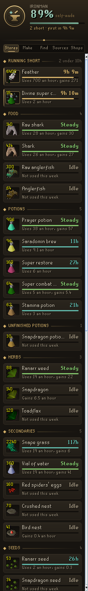
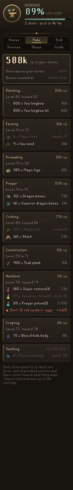
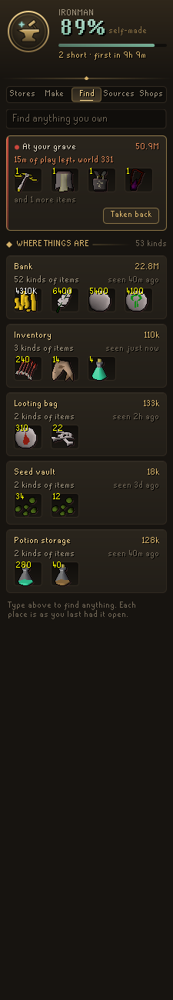
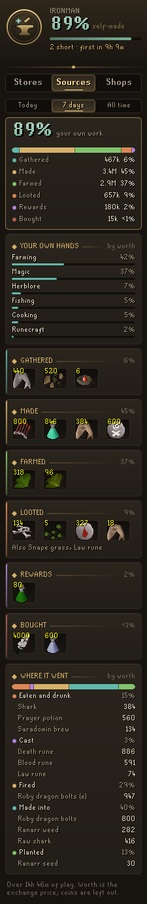
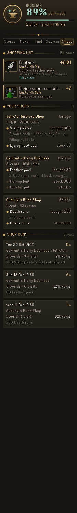
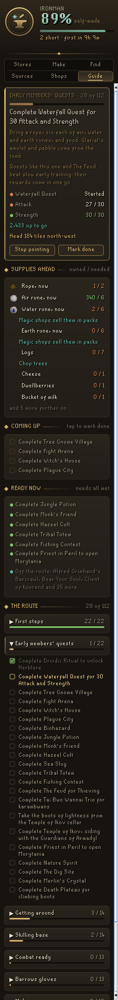

# Codex Ironworks

A RuneLite plugin for the ironman economy, in one app. An ironman lives on what they make, gather, loot and buy from shops, and Ironworks keeps the books: how long each of your stores lasts at the pace you actually play, what experience your stores hold, where anything you own is kept, where every potion, herb, rune and bolt came from and how to get more, and the shops you restock at, with what they charge and how fast each one fills again.

It brings together what a handful of single-purpose plugins do (banked experience, finding your items, item sources, supply tracking, shop restock timers, shop cost calculators and ironman guides) into six tabs that share one picture of your account.

It works for every kind of ironman (regular, hardcore, ultimate and group) and for main accounts too.

<p align="center">
  
  
  
  
  
  
</p>

## What it does

- **Stores tab.** Every staple an ironman keeps (food, potions, unfinished potions, herbs, secondaries, seeds, runes, ammunition, bones and ashes, materials, coins and tokens) on its own shelf. Each store shows what you hold everywhere (bank, potion storage, seed vault, looting bag, group storage and what you carry), how many of it you use and gain an hour, and how many hours of play it lasts. Potions are counted in doses, so four-dose and one-dose bottles are one store, and grimy and clean herbs are one store too.
- **Runways in hours of your own play.** The pace is measured over the last 7 days of time logged in, not calendar days, so a week away does not make your stores look endless. A store you gain at least as fast as you use is *Steady*. One that will not last your *Runway target* (10 hours by default) is *short* and goes to the top. One under *Running low* (2 hours) is marked in ember, and an empty one in red.
- **Where it came from.** Click a store and it opens to show where every unit came from (gathered, made, farmed, looted, rewards, bought, traded) with the skill it was made or gathered with, and where it went (eaten and drunk, cast, fired, made into something else, planted, offered, spent, sold, dropped, lost on death).
- **Make tab.** The experience waiting in your stores, worked out from 130 recipes across Herblore, Prayer, Cooking, Crafting, Fletching, Smithing, Construction, Firemaking, Farming and Magic. Each store goes to its best use first, and chains are followed through, so herbs and vials become unfinished potions and then potions, sand and soda ash become glass and then battlestaves. You see the experience per skill, the level it takes you to, and what each skill would make. Recipes above your level are counted apart. When a second ingredient runs out first, it says so ("Short 212 snape grass, +18.5k"). Bones count at the altar you choose (*Bones go to*). Levels and experience come from RuneLite's own skill calculator.
- **Find tab.** Search everything you own by name, wherever it is kept: bank, inventory, worn items, rune pouch, looting bag, seed vault, potion storage and group storage, each as you last had it open, even while logged out. Potions are counted in doses across every bottle size. Without a search, each place is shown with its worth and most valuable items.
- **Your last death.** When you die, Ironworks notes what you lost. The Find tab shows it on top with its worth, the play time left at your grave, and then that it waits at Death's Office. Items you pick back up are crossed off, and once nearly everything is back the death is settled.
- **Sources tab.** For today, the last 7 days or all time: how much of what came in you made or gathered yourself, weighed by worth so a hundred feathers do not outweigh a stack of runes, as one gilt percentage and a bar split by source. Below it are the ways to get more of what is short or used fastest (where to gather, farm, loot or buy it, the recipe that makes it, and the level each needs), with your own pace an hour for the ways you have used, timed only while you were at it. Then the skills that did the work, the biggest finds from each source, and where your supplies went.
- **Shops tab.** A shopping list of every store short of its runway, with how many you need and where to get them: "Buy 35 × Feather pack at Gerrant's Fishy Business" if you bought it before, with what it will cost, or how long it takes at your own pace if you gather it. Below that is every shop you have used, with what it sells, what you bought there, what you paid, and how fast it restocks.
- **Prices, learned.** Shops charge more for each item bought as the stock falls. Ironworks learns each item's first price and how fast it climbs from what you paid, shows the range on the shop card, and works out the cost of your whole shopping list when you hop worlds once the price is a tenth up.
- **Restock times, learned.** Ironworks watches shop stock climb back after you buy and learns how long each item takes to restock, per item and per shop. Shops keep stock per world, so when you hop it remembers each world you emptied and says when each will be full again.
- **Shop runs.** Shop visits close together are one run: the shops, how many worlds you hopped, what you bought and what it cost, and how long it took.
- **Guide tab.** A route for ironmen from a fresh account through the early members' quests, getting around, a skilling base, combat, Barrows gloves, the mid game and on toward the late game: over 300 steps: every quest, miniquest and achievement diary in the OSRS Wiki's optimal ironman quest order, with the wiki ironman guide's skilling, gear and unlock milestones woven in where they fall. Steps tick themselves as the game shows them done (quests finished or started, levels, quest points, and items Ironworks has seen you own), and a step you did another way can be marked done. Open any part of *The route* to see every step in it and tick or undo any of them; the steps the game has confirmed are sealed. The step in hand shows what the game checks and where you stand ("Attack 27 / 30"), and for a quest or diary, every unfinished quest down its chain and the levels they ask for, and when your stores hold the experience for a level the step needs, it says so. *Supplies ahead* adds up what the next steps use (rope, runes, logs, bones) against everything you own, so you can gather it before you need it, and says where to get what you lack: a shop you already buy from, or the best way to get more with how long it takes at your own measured pace. *Ready now* lists the quests further on that you already meet every requirement for, the ones only your stores stand between you and ("Train Herblore 52 from your stores first"), and how many quests off the route you could start, and a search on the Find tab also lists the route steps that use what you searched for.
- **Pointing the way.** Press *Point the way* and the game's hint arrow points at the person or place the step needs once it is near, what the step asks you to click is lit in gold, Quest Helper style: the person who starts a quest, the people and objects it names, items to buy in a shop, pick up or use, and the chat option to choose, and, if you have the Shortest Path plugin, it draws the way there. While you follow, a plaque in the game view shows the step in hand, what the game still waits to see, the supplies it still lacks, and which way to head (*Step plaque*).
- **Hands-free like Quest Helper.** The step in hand is pinned on the world map (click the pin at the map's edge to jump to it) and a gold arrow on the minimap points toward it however far away it is, turning into a ring on the spot once it is in sight (*Map pin and minimap arrow*). The items the step asks for glow gold in your bank and inventory, charged items like "Black mask (10)" included, so a bank trip is taking what glows. When the game shows the step done, chat says so and names the next one (*Step done in chat*). Once a quest on the route is under way, Ironworks steps aside: Quest Helper starts itself when a quest begins and leads it step by step, and Ironworks picks the route up again when the quest is done.
- **Shop plaque.** At a shop you have used before, a plaque in the game view shows what your stores need from it ("Buy 12 for 10h of play"), the stock now on this world, and how long it takes to fill (*Shop plaque*).
- **Low stores at the bank.** When you open your bank, a chat line names up to three stores that will run out within your *Running low* time, once a session each (*Low stores in chat*).
- **Item tooltips.** Hover an item in your inventory, bank or seed vault to see how much of its store you have, how long it lasts, what the Make tab would turn it into, and how many more of a missing ingredient would finish it (*Item tooltips*).
- **Others' loot last.** On an ironman, ground items that belong to another player cannot be taken, so their Take option is put below Walk here, and a misclick does not walk you over to them (*Others' loot last*).
- **Your own stores.** Add any item to track with *Also track*, or hide a store you don't care about with *Never track*.

## How it tells where things came from

Ironworks reads what you carry every tick and files each change by what else happened on that tick: the experience you gained, the menu option you just clicked, whether a shop or trade window was open, whether you died.

- An item that arrives with Farming experience was **farmed**; with Fishing, Mining, Woodcutting, Hunter or Thieving, **gathered**; with Herblore, Cooking, Smithing, Fletching, Crafting or Runecraft, **made** (fishing and cooking on the same tick are told apart by the item). Picked up from the ground, it was **looted**; opened from a crate or casket, a **reward**; bought at a shop or opened from a pack bought there, **bought**.
- An item that leaves when you eat or drink is **consumed**. Runes that leave are **cast** and ammunition is **fired**, with or without experience, since a missed shot uses the bolt all the same. Seeds that leave with Farming experience are **planted**, bones with Prayer **offered**, and anything that leaves with a production skill is **made into** something else.
- Moving things to and from a bank, deposit box, seed vault, group storage or leprechaun is a move, not a gain or a loss. Putting coal in a coal bag or herbs in a herb sack is a move too; what comes out that never went in arrived unseen and is put down to what you had been doing lately, so a fish barrel emptied at the bank counts as fish you caught.
- Each bank visit is checked whole. What the bank holds beyond what you left and what you brought arrived unseen (from a sack or barrel), and a stamina potion drunk at the bank is still drunk.
- Items lost on death wait in a grave. Pick them up again and nothing was lost; leave them, and they are counted as lost on death.
- Selling, trading, dropping and dying never set the pace of your runways: they are one-off choices or accidents, not how fast you play through your stores.

## Settings

- **Runway target** (10 hours): how long you want each store to last; anything shorter goes on the shopping list.
- **Running low** (2 hours): under this a store is running low.
- **Low stores in chat** (on): the chat line at the bank.
- **Shop plaque** (on): the plaque at shops.
- **Item tooltips** (on): store and recipe tooltips on items.
- **Others' loot last** (on): Take below Walk here on loot you cannot take, on ironmen only.
- **Bones go to** (Gilded altar): buried, gilded altar, Ectofuntus or the Wilderness chaos altar, for the Prayer experience the Make tab counts.
- **Hint arrow**, **Highlight clicks**, **Step plaque**, **Map pin and minimap arrow**, **Step done in chat** and **Shortest Path** (on): how the Guide points the way while you follow it.
- **Also track** and **Never track**: item names to add as stores, or stores to leave out, separated by commas.

## With other Codex plugins

The Guide reads its route in the same format as Codex Nomad's ultimate ironman route, so both plugins tick and point the same way. Quest start points and who starts each quest come from the Quest Helper plugin (BSD 2-Clause). Quest requirements come from the [Fate Locked](https://github.com/Nubles/OSRS-Fate-Locked) dataset.

Before Ironworks has seen your bank, it starts from the shared copy Codex Bank Steward keeps (`codexbanksteward/bankV1`), if you have it installed. It only reads it, and works the same without it.

## How it works

The inventory, worn items and rune pouch are read every tick and saved item by item when they change; the bank, seed vault, looting bag and group storage as they change, and the bank's potion storage with the game's own dose script while the bank is open. Shop stock is read from the shop window while it is open. Experience comes from `StatChanged`, menu clicks from `MenuOptionClicked`, deaths from `ActorDeath`, and the account type from the ironman varbit. Worth comes from RuneLite's item manager. Levels come from the client, and ground item ownership from the tile's items when a Take option is added. Everything is stored per account in the RuneLite profile config as one compact entry: lifetime totals for every store, 45 days of daily detail, each place item by item, the last death, your paces, up to 60 shops with their last 16 purchases and the last 40 runs. A damaged save never stops the panel: whatever still reads is used, and the save as it was is set aside in your profile before it is written over.

It is guidance only. It does not automate any input, send any data off the client, or read or write files. The only menu change is the optional one above, which moves a Take option down the menu and never removes or adds one.

## Building

```
./gradlew build
```

`./gradlew run` starts a development client with the plugin loaded.

## License

BSD 2-Clause. See [LICENSE](LICENSE).
