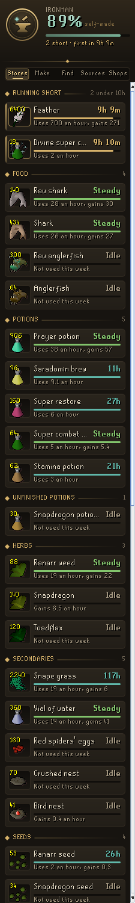
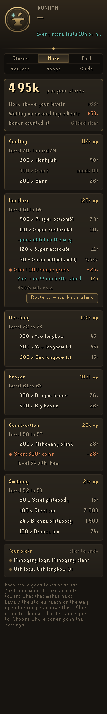
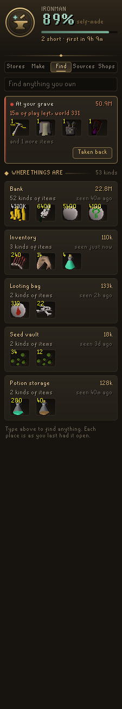
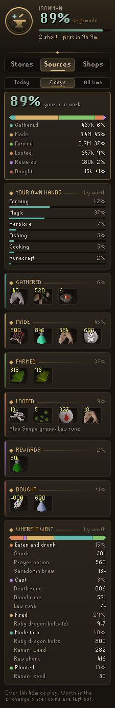
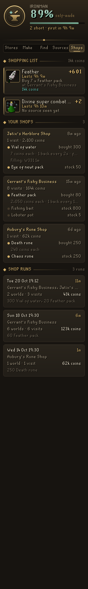
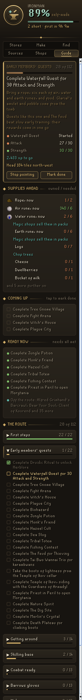

# Codex Ironworks

A RuneLite plugin for the ironman economy, in one app. An ironman lives on what they make, gather, loot and buy from shops, and Ironworks keeps the books: how long each of your stores lasts at the pace you actually play, what experience your stores hold, where anything you own is kept, where every potion, herb, rune and bolt came from and how to get more, and the shops you restock at, with what they charge and how fast each one fills again.

It brings together what a handful of single-purpose plugins do (banked experience, finding your items, item sources, supply tracking, shop restock timers, shop cost calculators and ironman guides) into six tabs that share one picture of your account.

It works for every kind of ironman (regular, hardcore, ultimate and group) and for main accounts too.

<p align="center">
  
  
  
  
  
  
</p>

## What it does

- **Stores tab.** Every staple an ironman keeps (food, potions, unfinished potions, herbs, secondaries, seeds, runes, ammunition, bones and ashes, materials, coins and tokens) on its own shelf. Each store shows what you hold everywhere (bank, potion storage, seed vault, looting bag, group storage and what you carry), how many of it you use and gain an hour, and how many hours of play it lasts. Potions are counted in doses, so four-dose and one-dose bottles are one store, and grimy and clean herbs are one store too.
- **Runways in hours of your own play.** The pace is measured over the last 7 days of time logged in, not calendar days, so a week away does not make your stores look endless. A store you gain at least as fast as you use is *Steady*. One that will not last your *Runway target* (10 hours by default) is *short* and goes to the top. One under *Running low* (2 hours) is marked in ember, and an empty one in red.
- **Where it came from.** Click a store and it opens to show where every unit came from (gathered, made, farmed, looted, rewards, bought, traded) with the skill it was made or gathered with, and where it went (eaten and drunk, cast, fired, made into something else, planted, offered, spent, sold, dropped, lost on death).
- **Make tab.** The experience waiting in your stores, worked out from 199 recipes across Herblore, Prayer, Cooking, Crafting, Fletching, Smithing, Construction, Firemaking, Farming, Magic, Runecraft and Sailing. Sailing brings its own: salvage from shipwrecks waits as Sailing experience until you sort it at a salvaging station, the fish trawled and harpooned at sea (haddock to marlin) are cooked, camphor, ironwood and rosewood logs are burned or taken to the sawmill for the planks that become hull parts, lead and nickel ore become bars, and bars and planks can be picked to become keel and hull parts for your boat. Each store goes to its best use first, and chains are followed through, so herbs and vials become unfinished potions and then potions, ores become bars and bars become platebodies, and sand and soda ash become glass and then battlestaves. You see the experience per skill, the level it takes you to, and what each skill would make. The levels your stores reach on the way count: a recipe above your level today opens once the experience made before it gets you there ("opens at 63 on the way"), and only what is still out of reach is counted apart. Second ingredients you actually hold limit the count, and the one that runs out first is named with what it would add and the level it would take you to ("Short 280 snape grass, +25k"), followed by the fastest way to get more for this account from the Sources tab, with a **Route** button when Codex Wayfinder is on. Click a line to choose what its store goes to (string or cut the bows, burn the logs, take them to the sawmill for planks, hammer bars into keel parts, or keep them as they are); your picks are listed at the foot of the tab, a click from going back. Bones count at the altar you choose (*Bones go to*). Levels and experience come from RuneLite's own skill calculator, and a test checks every recipe against it.
- **Essence pouches and your own runecrafting trips.** The Make tab's Runecrafting card reads each essence pouch you carry from the game's own counts: what it holds now, what it holds as worn today (the colossal pouch's room grows with your Runecraft level, 8 from 25 up to 40 from 85), and how far it is from shrinking, as fills it is sure to take and the essence it takes on average. A pouch that could shrink on its next fill turns ember, one that has worn turns red, and chat says so once with how to have it repaired: the Dark Mage in the Abyss repairs every pouch for free, and Astral Contact reaches him from anywhere (*Pouch wear in chat*). The same card shows the essence on you, in your pack and in your pouches, and your trips rune by rune, measured from what you craft: essence a trip, runes an essence (multiples included), and runes an hour over whole rounds, bank and running included, not just the seconds at the altar. That rate is the one the Sources tab plans runes with ("Craft them at the Nature Altar", timed at your own pace), and the pure essence in your stores is counted as Runecraft experience at the altar your trips craft at, with the trips, time and runes it comes to.
- **Find tab.** Search everything you own by name, wherever it is kept: bank, inventory, worn items, rune pouch, looting bag, seed vault, potion storage and group storage, each as you last had it open, even while logged out. Potions are counted in doses across every bottle size. Without a search, each place is shown with its worth and most valuable items.
- **Your last death.** When you die, Ironworks notes what you lost. The Find tab shows it on top with its worth, the play time left at your grave, and then that it waits at Death's Office. Items you pick back up are crossed off, and once nearly everything is back the death is settled.
- **Sources tab.** For today, the last 7 days or all time: how much of what came in you made or gathered yourself, weighed by worth so a hundred feathers do not outweigh a stack of runes, as one gilt percentage and a bar split by source. Below it are the ways to get more of what is short or used fastest (where to gather, farm, loot or buy it, the recipe that makes it, and the level each needs), with your own pace an hour for the ways you have used, timed only while you were at it. Then the skills that did the work, the biggest finds from each source, and where your supplies went.
- **Your own herbiboar log.** Hunting the herbiboar on Fossil Island (80 Hunter, boostable for the start of a trail; 31 Herblore to harvest; Bone Voyage to reach the island) is logged per account from the herbs each harvest puts in your pack: herbs a harvest by kind, kept apart for each stretch of Herblore levels where the herbs on offer change (lantadyme from 41, dwarf weed from 62, snapdragon from 74, torstol from 77; harralander, tarromin and marrentill stop after 76, 77 and 80), and trails an hour timed harvest to harvest, so the whole trail counts, not the moment of the harvest. The Sources tab shows it as herbs an hour at your pace, herb by herb, with the Herblore experience the harvests give (25 for each herb past the first) and the experience those herbs bank as the best potion you can make; the same herbs an hour time "Hunt the herbiboar" wherever Ironworks ranks ways to get a herb, and the herbiboar is only offered for the herbs it gives at your Herblore level. Following the trail itself is left to RuneLite's own Herbiboar plugin.
- **Tree coach and your own woodcutting log.** While you chop, a small plaque over the tree says how many people are chopping it (everyone swinging an axe while facing it, you among them) and how much of its hidden Forestry timer is left. The OSRS Wiki gives each tree's timer in ticks of chopping (oak 45, willow and teak 50, maple and mahogany 100, arctic pine 140, yew 190, camphor 200, magic 390, ironwood 400, redwood 440, rosewood 458), starting at the first log and growing back when nobody chops; Ironworks counts the ticks it sees against that. The wiki does not say how fast the timer grows back or whether more people run it down faster, so the coach follows the Tree Despawn Timer plugin's account (one tick off for each tick anyone chops, one back for each tick nobody does) and always calls its figure an estimate. If others were chopping before you came, it shows a range, at most what the ticks seen leave, and narrows it as the tree grows back. Trees grown in a Farming patch keep no timer and regular trees fall with their first log, and the coach says so. Once a tree falls it shows when it grows back. Your logs are logged per account tree by tree: logs an hour timed log to log at the tree (the wait for a felled tree to grow back counts, a bank trip does not), and how long your trees took to fall when seen from the first log, against the wiki's figure. The Sources tab shows it with the Woodcutting experience an hour and what those logs bank an hour in Firemaking, Fletching and Construction (planks from the sawmill) at your levels, and the same pace times "Chop ... trees" wherever Ironworks ranks ways to get logs. The plaque can be turned off with *Tree coach*.
- **Your own mining log and rock respawn estimates.** While you mine, Ironworks logs per account the ore that arrives, by rock and by the pickaxe you swing (read from your mining animation): ore an hour timed ore to ore at the rock (the wait for a mined rock to come back counts, a bank trip does not), and Mining experience an hour at the OSRS Wiki's experience for each ore (clay 5, copper and tin 17.5, iron 35, silver 40, coal 50, gold and gem rocks 65, mithril 80, adamantite 95, runite 125, amethyst 240). The Sources tab shows it with the rock that gives you the most experience an hour at your Mining level, the best rock your level opens that you have not tried yet, how long each ore your plans are short of takes at your own pace, the uncut gems and clue geodes (or scroll boxes) that turned up, and how often a gem came. The same pace times "Mine it" wherever Ironworks ranks ways to get an ore. Over each rock near you that has been mined out, a small plaque gives an estimate of when it comes back, counted down from the wiki's respawn time (clay 1.2 seconds, copper and tin 2.4, iron 5.4, coal 30, gem rocks 59.4, silver and gold a minute, amethyst 75 seconds, mithril 2 minutes, adamantite 4, runite 12). The wiki notes faster rocks in the Mining Guild's members' area and runite in the Wilderness, so those plaques say the time varies; once you have seen three rocks come back in one place, the plaque uses your own average there instead and says so. It is always called an estimate. The Motherlode Mine is left to Codex Minigame Pilot. The plaques can be turned off with *Rock respawn estimates*.
- **Your own deep sea trawling log.** While you trawl from your boat, Ironworks logs per account the fish that come up in your net, fish by fish (giant krill, haddock, yellowfin, halibut, bluefin and marlin, from the shoals the OSRS Wiki opens at 69, 73, 79, 83, 87 and 91 Fishing): fish an hour timed catch to catch while you keep with a shoal (a gap over three minutes is not timed), with the Fishing and Sailing experience that came in between. A catch only counts while the net is rolling, which the wiki marks by Sailing experience on each roll, so a fish caught any other way is left out. The Sources tab shows it with the fish that gives you the most Fishing experience an hour at your level, the best shoal your level opens that you have not trawled (with the wiki's experience a catch), and how long the trawled fish your plans are short of take at your own pace. The same pace times "Trawl ... shoals at sea" wherever Ironworks ranks ways to get these fish. Which net or boat you used is not told apart, as the game does not show it in a way Ironworks can read with confidence.
- **Fastest way to get it.** For what is short, or used fastest, the Sources tab ranks every way to get more by how long it takes this account to cover the shortfall: the trip there from where you stand with the teleports you own (from Codex Wayfinder), plus the work at your own measured pace, or the OSRS Wiki's rate until Ironworks has timed you. Spots to gather at (wine of Zamorak at the Chaos Temple, 204 an hour; snape grass on Waterbirth Island, 950; red spiders' eggs in the Varrock Sewers, 390; white berries in Isafdar, 400; mort myre fungus by Ver Sinhaza, 1,620), shops (Gerrant's 100 packs of 100 feathers a world, and every shop you have bought it at, from the stock you saw), drops (chickens at 6.25 feathers a kill, hill giants at 11/128 for a limpwurt root, given in kills until you have looted at a pace) and recipes (at your own making pace) are compared on one clock. Ways your levels do not reach yet go last, with the level they need. With Wayfinder on, a **Route** button plots the way to the best one.
- **Shops tab.** A shopping list of every store short of its runway, with how many you need and where to get them: "Buy 35 × Feather pack at Gerrant's Fishy Business" if you bought it before, with what it will cost, or how long it takes at your own pace if you gather it. Below that is every shop you have used, with what it sells, what you bought there, what you paid, and how fast it restocks.
- **Prices, learned.** Shops charge more for each item bought as the stock falls. Ironworks learns each item's first price and how fast it climbs from what you paid, shows the range on the shop card, and works out the cost of your whole shopping list when you hop worlds once the price is a tenth up.
- **Restock times, learned.** Ironworks watches shop stock climb back after you buy and learns how long each item takes to restock, per item and per shop. Shops keep stock per world, so when you hop it remembers each world you emptied and says when each will be full again.
- **Shop runs.** Shop visits close together are one run: the shops, how many worlds you hopped, what you bought and what it cost, and how long it took.
- **Guide tab.** A route for ironmen from a fresh account through the early members' quests, getting around, a skilling base, combat, Barrows gloves, the mid game and on toward the late game: over 430 steps: every quest, miniquest and achievement diary in the OSRS Wiki's optimal ironman quest order, the training each quest needs ("Train Agility to 25"), quests to start early and finish later, and the wiki ironman guide's skilling, gear and unlock milestones woven in where they fall. Under each step, *Along the way* lists the wiki's notes for it, what to gather, buy and do nearby for later quests and diaries, each one a box to tick off as you go. Steps tick themselves as the game shows them done (quests finished or started, levels, quest points, and items Ironworks has seen you own), and a step you did another way can be marked done. Open any part of *The route* to see every step in it and tick or undo any of them; the steps the game has confirmed are sealed. The step in hand shows what the game checks and where you stand ("Attack 27 / 30"), and for a quest or diary, every unfinished quest down its chain and the levels they ask for, and when your stores hold the experience for a level the step needs, it says so. *Supplies ahead* adds up what the next steps use (rope, runes, logs, bones) against everything you own, so you can gather it before you need it, and says where to get what you lack: a shop you already buy from, or the best way to get more with how long it takes at your own measured pace. *Ready now* lists the quests further on that you already meet every requirement for, the ones only your stores stand between you and ("Train Herblore 52 from your stores first"), and how many quests off the route you could start, and a search on the Find tab also lists the route steps that use what you searched for.
- **Pointing the way.** Press *Point the way* and the game's hint arrow points at the person or place the step needs once it is near, what the step asks you to click is lit in gold, Quest Helper style: the person who starts a quest, the people and objects it names, items to buy in a shop, pick up or use, and the chat option to choose, and, if you have the Shortest Path plugin, it draws the way there. While you follow, a plaque in the game view shows the step in hand, what the game still waits to see, the supplies it still lacks, and which way to head (*Step plaque*).
- **Hands-free like Quest Helper.** The step in hand is pinned on the world map (click the pin at the map's edge to jump to it) and a gold arrow on the minimap points toward it however far away it is, turning into a ring on the spot once it is in sight (*Map pin and minimap arrow*). The items the step asks for glow gold in your bank and inventory, charged items like "Black mask (10)" included, so a bank trip is taking what glows. When the game shows the step done, chat says so and names the next one (*Step done in chat*). Once a quest on the route is under way, Ironworks steps aside: Quest Helper starts itself when a quest begins and leads it step by step, and Ironworks picks the route up again when the quest is done.
- **Shop plaque.** At a shop you have used before, a plaque in the game view shows what your stores need from it ("Buy 12 for 10h of play"), the stock now on this world, and how long it takes to fill (*Shop plaque*).
- **Low stores at the bank.** When you open your bank, a chat line names up to three stores that will run out within your *Running low* time, once a session each (*Low stores in chat*).
- **Item tooltips.** Hover an item in your inventory, bank or seed vault to see how much of its store you have, how long it lasts, what the Make tab would turn it into, and how many more of a missing ingredient would finish it (*Item tooltips*).
- **Others' loot last.** On an ironman, ground items that belong to another player cannot be taken, so their Take option is put below Walk here, and a misclick does not walk you over to them (*Others' loot last*).
- **Your own stores.** Add any item to track with *Also track*, or hide a store you don't care about with *Never track*.

## How it tells where things came from

Ironworks reads what you carry every tick and files each change by what else happened on that tick: the experience you gained, the menu option you just clicked, whether a shop or trade window was open, whether you died.

- An item that arrives with Farming experience was **farmed**; with Fishing, Mining, Woodcutting, Hunter or Thieving, **gathered**; with Herblore, Cooking, Smithing, Fletching, Crafting or Runecraft, **made** (fishing and cooking on the same tick are told apart by the item). Picked up from the ground, it was **looted**; opened from a crate or casket, a **reward**; bought at a shop or opened from a pack bought there, **bought**.
- An item that leaves when you eat or drink is **consumed**. Runes that leave are **cast** and ammunition is **fired**, with or without experience, since a missed shot uses the bolt all the same. Seeds that leave with Farming experience are **planted**, bones with Prayer **offered**, and anything that leaves with a production skill is **made into** something else.
- Moving things to and from a bank, deposit box, seed vault, group storage or leprechaun is a move, not a gain or a loss. Putting coal in a coal bag or herbs in a herb sack is a move too; what comes out that never went in arrived unseen and is put down to what you had been doing lately, so a fish barrel emptied at the bank counts as fish you caught.
- Each bank visit is checked whole. What the bank holds beyond what you left and what you brought arrived unseen (from a sack or barrel), and a stamina potion drunk at the bank is still drunk.
- Items lost on death wait in a grave. Pick them up again and nothing was lost; leave them, and they are counted as lost on death.
- Selling, trading, dropping and dying never set the pace of your runways: they are one-off choices or accidents, not how fast you play through your stores.

## Settings

- **Runway target** (10 hours): how long you want each store to last; anything shorter goes on the shopping list.
- **Running low** (2 hours): under this a store is running low.
- **Low stores in chat** (on): the chat line at the bank.
- **Shop plaque** (on): the plaque at shops.
- **Item tooltips** (on): store and recipe tooltips on items.
- **Others' loot last** (on): Take below Walk here on loot you cannot take, on ironmen only.
- **Pouch wear in chat** (on): a chat line when an essence pouch you carry could shrink on its next fill, or has worn.
- **Tree coach** (on): the plaque over the tree you are chopping, with who is chopping it and the estimated time left on its Forestry timer.
- **Rock respawn estimates** (on): while you mine, a plaque over each mined-out rock near you with an estimate of when it comes back.
- **Travel with Wayfinder** (on): with Codex Wayfinder on, cost each way to get more by real travel time with your teleports and show a Route button.
- **Bones go to** (Gilded altar): buried, gilded altar, Ectofuntus or the Wilderness chaos altar, for the Prayer experience the Make tab counts.
- **Hint arrow**, **Highlight clicks**, **Step plaque**, **Map pin and minimap arrow**, **Step done in chat** and **Shortest Path** (on): how the Guide points the way while you follow it.
- **Also track** and **Never track**: item names to add as stores, or stores to leave out, separated by commas.

## With other Codex plugins

The Guide reads its route in the same format as Codex Nomad's ultimate ironman route, so both plugins tick and point the same way. Quest start points and who starts each quest come from the Quest Helper plugin (BSD 2-Clause). Quest requirements come from the [Fate Locked](https://github.com/Nubles/OSRS-Fate-Locked) dataset.

With Codex Wayfinder installed, Ironworks reads the travel atlas it shares (`codexwayfinder/atlasV1`: the teleports this account owns, their landing tiles and seconds, and your walking pace) and never writes it. A teleport kept in the bank is counted with a minute added for the bank stop, and a shop visit (hop, open, buy the world's stock) is counted as 30 seconds; both are planning assumptions, not game facts. The Route button sends Wayfinder the plugin messages `route` (answered with `routed`, whose time Ironworks then shows) and `show` on the `codexwayfinder` namespace. Without Wayfinder, the plan is ranked on work alone and there is no Route button.

Before Ironworks has seen your bank, it starts from the shared copy Codex Bank Steward keeps (`codexbanksteward/bankV1`), if you have it installed. It only reads it, and works the same without it.

## How it works

The inventory, worn items and rune pouch are read every tick and saved item by item when they change; the bank, seed vault, looting bag and group storage as they change, and the bank's potion storage with the game's own dose script while the bank is open. Shop stock is read from the shop window while it is open. Essence pouches are read from the game's own pouch counts and wear counters while you carry them, and runecrafting trips from the runes that arrive with Runecraft experience and the essence that leaves with it. Herbiboar harvests are the herbs that arrive while you stand in the map squares RuneLite's own Herbiboar plugin tracks it in. The tree coach reads the tree you face while swinging an axe, by its object name, and the other players near it from their animation and the way they face; logs are the ones that arrive with Woodcutting experience. Mining reads the pickaxe from your animation and the rock you face by its object name; ore, gems and clues are the ones that arrive while you swing, and a rock is seen mined out when it leaves its tile outside a scene load. Trawled fish are read from your boat's trawling net as the game sends it, or else from the catch message, and only while Sailing experience shows the net rolling. Experience comes from `StatChanged`, menu clicks from `MenuOptionClicked`, deaths from `ActorDeath`, and the account type from the ironman varbit. Worth comes from RuneLite's item manager. Levels come from the client, and ground item ownership from the tile's items when a Take option is added. Everything is stored per account in the RuneLite profile config as one compact entry: lifetime totals for every store, 45 days of daily detail, each place item by item, the last death, your paces, up to 60 shops with their last 16 purchases and the last 40 runs. A damaged save never stops the panel: whatever still reads is used, and the save as it was is set aside in your profile before it is written over.

It is guidance only. It does not automate any input, send any data off the client, or read or write files apart from the optional field notes below. The only menu change is the optional one above, which moves a Take option down the menu and never removes or adds one.

## Building

```
./gradlew build
```

`./gradlew run` starts a development client with the plugin loaded.

## Field notes

An optional setting, **Keep field notes** (under Field notes, off by default), writes a plain record of what Ironworks reads and decides to its own folder in `.runelite/plugin-data` on your computer, one line at a time. It is for checking the plugin's guesses against real play: when something looks wrong, the notes show what it saw and why it chose what it did. Other players' chat is never written down, it stays on your computer, and nothing is sent anywhere.

## License

BSD 2-Clause. See [LICENSE](LICENSE).
